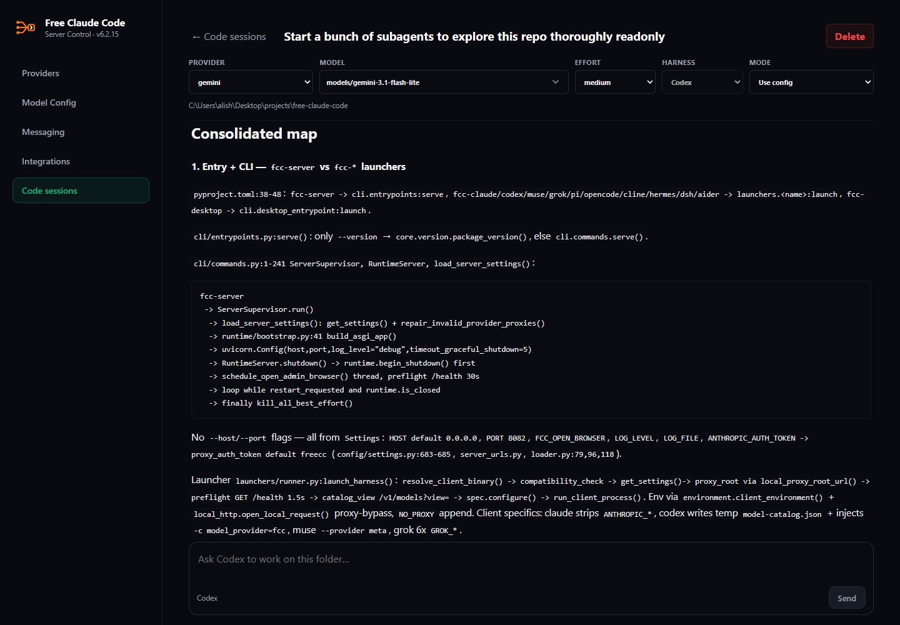

<div align="center">

<h1>
  <picture>
    <source media="(prefers-color-scheme: light)" srcset="assets/free-claude-code-wordmark-light.svg">
    
  </picture>
</h1>

[](https://github.com/lordjunnior/claude-code-gratis/blob/main/LICENSE)
[](https://www.python.org/downloads/)
[](https://github.com/astral-sh/uv)
[](https://github.com/lordjunnior/claude-code-gratis/actions/workflows/tests.yml)
[](https://pypi.org/project/ty/)
[](https://github.com/astral-sh/ruff)
[](https://github.com/Delgan/loguru)

[Início Rápido](#inicio-rapido) · [Provedores](#escolha-um-provedor) · [Clientes](#conecte-seu-cliente) · [Integrações](#integracoes-opcionais) · [Gerenciamento](#gerenciamento-da-instalacao)

</div>

<p align="center">
  <em>Projeto open source mantido por Lord Junnior. Não é afiliado nem endossado pela Anthropic. Claude e Claude Code são marcas registradas da Anthropic.</em>
</p>

## O Que Você Obtém

- **61 provedores compatíveis com os Termos de Serviço. Mais de 1,3 bilhão de tokens gratuitos mensais.** Utilize modelos gratuitos, pagos, por assinatura e locais a partir de uma interface única e pesquisável sem colocar sua conta em risco. O FCC segue rigorosamente os termos de cada provedor e remove integrações caso deixem de ser permitidas.
- **11 agentes de desenvolvimento. Um único catálogo de modelos.** Execute [Claude Code](https://code.claude.com/docs/en/overview), [Codex](https://github.com/openai/codex), [Pi](https://github.com/earendil-works/pi), [OpenCode](https://github.com/anomalyco/opencode), [Cline](https://github.com/cline/cline), [Hermes](https://github.com/NousResearch/hermes-agent), [DeepSeek Harness](https://github.com/deepseek-ai/deepseek-harness), [Grok Build](https://github.com/xai-org/grok-build), [Muse Code](https://research.meta.ai/blog/introducing-muse-code-and-muse-spark-1-2/), [Aider](https://aider.chat/) ou [VS Code Chat](https://code.visualstudio.com/) com seus modelos configurados no FCC.
- **Continue programando mesmo com quedas de provedores.** Após esgotar as tentativas de requisição, o FCC aciona automaticamente o próximo modelo configurado na fila sem forçar o reinício da sessão. Funciona de forma transparente em todos os clientes.
- **Redução de até 90% no consumo de tokens.** O módulo opcional [RTK](https://github.com/rtk-ai/rtk) filtra saídas repetitivas de terminal e o [Headroom](https://github.com/headroomlabs-ai/headroom) compacta os retornos de ferramentas e comandos.
- **Sessões nativas de código no navegador.** Escolha um diretório local e execute o Codex direto pelo navegador com suporte a processos em tempo real e em segundo plano. Alterne provedores e modelos livremente na mesma sessão.
- **Terminal, desktop, IDE ou celular.** Opere através de executáveis nativos de linha de comando, [VS Code](https://code.visualstudio.com/), [Codex App](https://learn.chatgpt.com/docs/app), [JetBrains](https://www.jetbrains.com/), [Discord](https://discord.com/) ou [Telegram](https://telegram.org/).
- **Entrada por notas de voz. Saída em código.** Converse com seu agente por comandos de áudio transcritos via [Whisper](https://github.com/openai/whisper) local ou [NVIDIA NIM](https://docs.nvidia.com/nim/speech/latest/asr/deploy-asr-models/whisper.html).
- **Recursos nativos dos agentes preservados.** Suporte a streaming de respostas, chamadas de ferramentas (tool use), raciocínio intercalado nativo (thinking process), envio de imagens e roteamento independente para as camadas [Fable](https://www.anthropic.com/claude/fable), [Opus](https://www.anthropic.com/claude/opus), [Sonnet](https://www.anthropic.com/claude/sonnet) e [Haiku](https://www.anthropic.com/claude/haiku) em modelos compatíveis.

A disponibilidade e os limites das cotas gratuitas são controlados por cada provedor e podem sofrer alterações.

<div align="center">
  
  <p><em>Claude Code executando com FCC.</em></p>
</div>

<div align="center">
  
  <p><em>Sessão nativa do Codex executando diretamente na interface web do FCC.</em></p>
</div>

<a id="inicio-rapido"></a>

## Início Rápido

<a id="install"></a>

### 1. Instalação

macOS / Linux:

```bash
curl -fsSL "[https://raw.githubusercontent.com/Alishahryar1/free-claude-code/main/scripts/install.sh](https://raw.githubusercontent.com/Alishahryar1/free-claude-code/main/scripts/install.sh)" | sh
Windows (PowerShell como Administrador):PowerShell& ([scriptblock]::Create((irm "[https://raw.githubusercontent.com/Alishahryar1/free-claude-code/main/scripts/install.ps1](https://raw.githubusercontent.com/Alishahryar1/free-claude-code/main/scripts/install.ps1)")))
Quando solicitado no assistente, selecione ao menos um agente de código e, opcionalmente, ative a otimização de tokens com RTK + Headroom nos agentes compatíveis.2. Iniciar o FCCWindowsAbra o atalho Free Claude Code na sua área de trabalho ou no Menu Iniciar.macOSAbra o aplicativo Free Claude Code na pasta Aplicativos ou na Mesa.LinuxExecute no terminal:Bashfcc-server
O FCC abrirá a interface administrativa (Admin UI) automaticamente. No Windows e no macOS, utilize o ícone na bandeja do sistema para acessar a administração, reiniciar ou encerrar. Ao iniciar pelo comando fcc-server, mantenha o terminal aberto.3. Configurar a NVIDIA NIMCrie uma chave de API gratuita em build.nvidia.com/settings/api-keys.Abra a URL da Admin UI exibida nos logs do servidor.No menu Providers, localize NVIDIA NIM, clique em Add key, cole a chave e clique em Save.Mantenha o campo MODEL com o padrão nvidia_nim/nvidia/nemotron-3-ultra-550b-a55b ou selecione outro modelo na lista.Clique em Apply para salvar a seleção.Para proteger o proxy local com token de acesso (Bearer token), ative a opção Proxy Authentication no painel Admin.4. Executar o Agente de CódigoClaude Code:Bashfcc-claude
Codex:Bashfcc-codex
Pi:Bashfcc-pi
OpenCode 2:Bashfcc-opencode
Cline:Bashfcc-cline
Hermes:Bashfcc-hermes
DeepSeek Harness Web:Bashfcc-dsh
Grok Build:Bashfcc-grok
Muse Code:Bashfcc-muse
Aider:Bashfcc-aider
Escolha um ProvedorAcesse o link do provedor desejado na tabela abaixo para obter sua chave ou consultar instruções.Na Admin UI, preencha o campo correspondente. Para login via conta ChatGPT / OpenAI por assinatura, acesse a aba Providers → OAuth providers.No campo MODEL, busque o modelo desejado. Se o provedor não listar automaticamente, digite manualmente no formato <id-do-provedor>/<id-exato-do-modelo>.Clique em Apply.Opcional: configure uma lista ordenada de contingência em Model Config → Fallback Models. Essa regra valerá para todos os clientes conectados: se o modelo primário esgotar as tentativas ou apresentar erro de limite, o FCC aciona o próximo da lista de forma automática.Os modais de provedores suportam múltiplas chaves numeradas. Use Add key, remova linhas indesejadas ou arraste para reordenar. O FCC utiliza a chave 1 por padrão.Para endpoints personalizados, acesse Providers → Custom providers → Add provider. Informe a URL base da API, chaves opcionais e o formato da API. Deixe o campo Model IDs vazio para detecção automática ou insira os identificadores de modelo linha por linha. Salve e selecione o modelo em Model Config.ProvedorConfiguração no Admin UIExemplo de MODELNVIDIA NIMNVIDIA_NIM_API_KEYnvidia_nim/nvidia/nemotron-3-ultra-550b-a55bOpenRouterOPENROUTER_API_KEYopen_router/openrouter/freeGroqGROQ_API_KEYgroq/llama-3.3-70b-versatileClinePassCLINE_API_KEYcline_pass/cline-pass/kimi-k3OpenAI / ChatGPTConectar ChatGPT via Admin UIopenai/<model-id>OpenAI APIOPENAI_API_KEYopenai_api/gpt-5.6-solGitHub CopilotConectar GitHub Copilot via Admin UIgithub_copilot/<model-id>xAI (Grok)XAI_API_KEYxai/grok-4.5Alibaba CloudALIBABA_CLOUD_API_KEYalibaba_cloud/<model-id>QwenCloud Token PlanQWENCLOUD_API_KEYqwencloud/qwen3.7-plusQwenCloud Coding PlanQWENCLOUD_CODING_API_KEYqwencloud_coding/qwen3.7-plusTogether AITOGETHER_API_KEYtogether/zai-org/GLM-5.2DeepInfraDEEPINFRA_API_KEYdeepinfra/deepseek-ai/DeepSeek-V4-FlashSiliconFlowSILICONFLOW_API_KEYsiliconflow/Qwen/Qwen3-32BNebius Token FactoryNEBIUS_API_KEYnebius/Qwen/Qwen3-30B-A3BChutesCHUTES_API_KEYchutes/Qwen/Qwen3-32B-TEEFeatherless AIFEATHERLESS_API_KEYfeatherless/Qwen/Qwen3-32BAgnes AIAGNES_API_KEYagnes/agnes-2.0-flashZenMuxZENMUX_API_KEYzenmux/deepseek/deepseek-v4-flash-freeW&B InferenceWANDB_API_KEYwandb/openai/gpt-oss-20bAnthropicANTHROPIC_API_KEYanthropic/<model-id>Azure OpenAIAZURE_OPENAI_API_KEY e AZURE_OPENAI_BASE_URLazure_openai/<deployment-name>Google AI Studio (Gemini)GEMINI_API_KEYgemini/models/gemini-3.1-flash-liteGoogle Vertex AIVERTEX_PROJECT_ID + ADCvertex/google/gemini-3.5-flashDeepSeekDEEPSEEK_API_KEYdeepseek/deepseek-chatMistral La PlateformeMISTRAL_API_KEYmistral/devstral-small-latestMistral CodestralCODESTRAL_API_KEYmistral_codestral/codestral-latestOpenCode ZenOPENCODE_API_KEYopencode_zen/gpt-5.3-codexOpenCode GoOPENCODE_API_KEYopencode_go/minimax-m2.7Vercel AI GatewayAI_GATEWAY_API_KEYvercel/openai/gpt-5.5Amazon BedrockAWS_BEARER_TOKEN_BEDROCKbedrock/openai.gpt-oss-120bHugging Face Inference ProvidersHUGGINGFACE_API_KEYhuggingface/Qwen/Qwen3-Coder-480B-A35B-Instruct:fastestCohereCOHERE_API_KEYcohere/command-a-plus-05-2026WaferWAFER_API_KEYwafer/DeepSeek-V4-ProKimi APIKIMI_API_KEYkimi/kimi-k2.5Kimi CodeKIMI_CODE_API_KEYkimi_code/k3MiniMaxMINIMAX_API_KEYminimax/MiniMax-M3Cerebras InferenceCEREBRAS_API_KEYcerebras/gpt-oss-120bSambaNovaSAMBANOVA_API_KEYsambanova/Meta-Llama-3.3-70B-InstructKilo.aiKILO_API_KEYkilo/kilo-auto/freeFireworks AIFIREWORKS_API_KEYfireworks/accounts/fireworks/models/llama-v3p3-70b-instructNovita AINOVITA_API_KEYnovita/deepseek/deepseek-v4-flash-0731Cloudflare Workers AICLOUDFLARE_API_TOKEN e CLOUDFLARE_ACCOUNT_IDcloudflare/@cf/moonshotai/kimi-k2.6Z.ai Coding PlanZAI_API_KEYzai/glm-5.2Z.ai API (pay as you go)ZAI_API_KEYzai_api/glm-4.7-flashTokenRouterTOKENROUTER_API_KEYtokenrouter/moonshotai/kimi-k3-freeNaraRouteNARAROUTE_API_KEYnararoute/kimi-k3-freePoolside AIPOOLSIDE_API_KEYpoolside/poolside/laguna-s-2.1LLM7.ioLLM7_API_KEYllm7/defaultScalewaySCW_SECRET_KEYscaleway/deepseek/deepseek-v4-flashLightning AILIGHTNING_API_KEYlightning/lightning-ai/Qwen3.8-27BExperiential LabsEXPLABS_API_KEYexperiential/union-alphaCheaper InferenceCHEAPER_INFERENCE_API_KEYcheaperinference/gpt-5.4-miniOrcaRouterORCAROUTER_API_KEYorcarouter/deepseek/deepseek-v4-flash-freeAtlas CloudATLASCLOUD_API_KEYatlascloud/deepseek-ai/deepseek-v4-flashxKiroXKIRO_API_KEYxkiro/qwen/qwen3.7-flash:freeOpperOPPER_API_KEYopper/claude-sonnet-4-6Ollama CloudOLLAMA_API_KEYollama_cloud/qwen3-coder:480bLM StudioLM_STUDIO_BASE_URLlmstudio/<model-id>llama.cppLLAMACPP_BASE_URLllamacpp/<model-id>OllamaOLLAMA_BASE_URLollama/<model-tag>OpenAI / ChatGPT: Utiliza a sua assinatura ativa do ChatGPT em vez de créditos de API. Conecte em Providers → OAuth providers → OpenAI / ChatGPT → Connect na Admin UI e conclua o login pelo navegador. Reinicie o agente caso ele já esteja em execução.Anthropic: Utiliza chaves de API com cobrança separada. Configure em Providers → Cloud providers → Anthropic → Configure. Chaves com múltiplos workspaces também exigem a variável ANTHROPIC_WORKSPACE_ID.OpenAI API: Requer chave de plataforma tradicional. Configure em Providers → Cloud providers → OpenAI API → Configure. Escolha exclusivamente modelos de geração de texto/código.GitHub Copilot: Conecta à sua assinatura do GitHub. Instale o Copilot CLI 1.0.83 no seu PATH e conecte em Providers → OAuth providers → GitHub Copilot → Connect. Modelos e limites dependem das permissões do seu plano.Azure OpenAI: Configure AZURE_OPENAI_BASE_URL com a URL completa do endpoint v1 (ex.: https://SEU-RECURSO.openai.azure.com/openai/v1/) e selecione um deployment com suporte a Chat Completions. Insira o nome do deployment caso ele não apareça automaticamente na lista.Mistral Codestral: Utiliza chave de API independente do console padrão da Mistral.Kimi Code / Kimi API: Planos por assinatura utilizam o prefixo kimi_code/, enquanto chaves de créditos avulsos utilizam kimi/.Alibaba Cloud: Utiliza chave Model Studio pay-as-you-go e tem como região padrão Singapura. Para outras regiões, ajuste ALIBABA_CLOUD_BASE_URL para o endpoint compatível terminando em /compatible-mode/v1.QwenCloud: Chaves do Coding Plan usam qwencloud_coding/ e o Token Plan usa qwencloud/. Elas não são intercambiáveis entre si.OpenCode Zen e Go: Compartilham a mesma OPENCODE_API_KEY, mas exigem explicitamente os prefixos opencode_zen/ ou opencode_go/.Amazon Bedrock: Aponte BEDROCK_BASE_URL para a mesma região configurada na chave de API da AWS.Vertex AI (Google Cloud): Utiliza Application Default Credentials (ADC) em vez de chave direta. Execute localmente gcloud auth application-default login uma vez, configure VERTEX_PROJECT_ID e ajuste VERTEX_LOCATION se necessário.Cloudflare: Exige simultaneamente o Token de API e o Account ID.Ollama Cloud: Insira o identificador exato exibido no seletor de modelos. O Ollama local utiliza o prefixo próprio ollama/.Recomendação geral: Prefira modelos com suporte oficial a chamadas de ferramentas (tool-use). Em modelos locais, garanta contexto de memória suficiente para carregar os prompts de sistema e as ferramentas do agente.O FCC localiza e lista automaticamente modelos de servidores locais ativos durante a inicialização. Se você abrir o servidor local depois, clique em Refresh models no painel Admin para atualizar a lista.LM StudioInicie o servidor local do LM Studio, carregue um modelo compatível com ferramentas e utilize o identificador com o prefixo lmstudio/. A URL padrão é http://localhost:1234/v1.llama.cppInicie o llama-server expondo a API compatível com OpenAI Chat Completions com contexto suficiente alocado. Use o prefixo llamacpp/. O endereço padrão em LLAMACPP_BASE_URL é http://localhost:8080/v1.OllamaBashollama pull llama3.1
ollama serve
Utilize a tag exibida no comando ollama list com o prefixo ollama/. O endereço padrão em OLLAMA_BASE_URL é http://localhost:11434.Os cards de provedores locais mostram o status da conexão e a latência de resposta. Caso o servidor esteja inacessível, inicie o serviço e clique em Test para restaurar a lista de modelos.A variável global MODEL serve como contingência para todas as solicitações. Você pode configurar substituições específicas para cada nível do Claude Code preenchendo MODEL_FABLE, MODEL_OPUS, MODEL_SONNET ou MODEL_HAIKU. Selecione None para manter o padrão global.No menu Admin UI → Model Config, organize a lista de Fallback Models na ordem em que o FCC deve acioná-los caso ocorram falhas. Cada fallback possui sua própria intensidade de raciocínio (reasoning effort): Inherit, Off, From client, Low, Medium, High, X-High ou Max.Escolha o modelo, o nível de esforço e o número da chave na barra inferior e clique em +. As opções Key 1, Key 2, etc., apontam para as chaves cadastradas naquele provedor. Arraste as linhas para ajustar a prioridade de fallback ou clique no ícone da lixeira para remover.Inherit mantém o nível de raciocínio da requisição original. From client repassa o orçamento de tokens ou esforço solicitado diretamente pelo agente de código.Acesse Admin UI → Model Config → Model Routing para configurar o nível de esforço de raciocínio de cada modelo. A opção Default Effort inicia como From client. As camadas Fable, Opus, Sonnet e Haiku iniciam com Inherit.OpçãoComportamentoFrom clientRepassa exatamente o nível de esforço solicitado pelo agente. Se não houver, adota o padrão do provedor.OffForça a desativação de rotinas de raciocínio estendido / chain-of-thought.Low, Medium, High, X-High ou MaxSobrescreve as instruções do cliente aplicando o nível fixado selecionado.InheritCamadas herdadas utilizam o valor de Default Effort. Fallbacks mantêm a resolução original da requisição.Conecte seu ClienteOs inicializadores de terminal do FCC abrem o servidor local em segundo plano de forma automática.Para editores e ferramentas integradas, instale o cliente correspondente, inicie o FCC, acesse Admin UI → Integrations e clique em Connect no respectivo painel:Claude Code no VS Code: Instale a extensão oficial Claude Code.VS Code Chat: Instale o VS Code atualizado, conecte e selecione um modelo do FCC no seletor nativo do chat.Claude Desktop: Instale o [suspicious link removed]. Feche o app completamente antes de conectar ou desconectar. Ao desconectar, ele retorna ao login padrão da Anthropic.Codex no VS Code e Aplicativo: Instale a extensão Codex ou utilize o Codex App oficial.DeepSeek Harness Desktop: Instale e execute o app uma vez antes de conectar no FCC. Abra uma nova sessão para usar os modelos.Claude Code no JetBrains ACP: Instale o Claude Agent no JetBrains AI Assistant, execute-o uma vez e clique em Connect no FCC. Reabra a IDE, escolha Claude Code (FCC) e inicie uma nova conversa.Recarregue o VS Code ou reinicie sua IDE após conectar. No Codex e no Claude Desktop, escolha o modelo do FCC pelo menu dropdown interno.Para concluir o onboarding do Claude Code de forma isolada, acesse Admin UI → Integrations → Claude Code onboarding e clique em Complete onboarding. Conectar o Claude Code no VS Code conclui essa etapa automaticamente.Execute o FCC no mesmo computador e sob o mesmo usuário do sistema operacional em que seus editores estão instalados.Integrações OpcionaisConfigure as opções em Admin UI → Messaging e clique em Apply.Crie uma aplicação no Discord Developer Portal.Ative a permissão Message Content Intent e convide o bot para seu servidor com permissões de ler, enviar, acessar histórico e Manage Messages (necessário para o comando /clear remover mensagens de prompt).Defina a plataforma como discord.Insira o Discord Bot Token, os canais autorizados em Allowed Discord Channels e o diretório absoluto de trabalho em Allowed Directory.Salve as alterações e reinicie o servidor se solicitado.Crie um novo bot conversando com o @BotFather.Descubra seu ID numérico de usuário usando o @userinfobot. Se for usar em grupos, conceda permissão de apagar mensagens ao bot.Defina a plataforma como telegram.Insira o Telegram Bot Token, seu ID em Allowed Telegram User ID e o diretório local permitido em Allowed Directory.Salve as alterações e reinicie o servidor se solicitado.Comandos de MensagensComandoAção/statsExibe o estado e consumo atual da sessão./stop (mensagem isolada)Cancela todas as tarefas em andamento.Responder com /stopCancela pontualmente a requisição respondida, mantendo as demais na fila./clear (mensagem isolada)Limpa todo o histórico de conversas do FCC no canal.Responder com /clearRemove a mensagem respondida e todo o encadeamento de respostas dela.O suporte a transcrição via NVIDIA NIM vem habilitado por padrão. Em Admin UI → Messaging → Voice, ative as mensagens de voz, marque nvidia_nim, escolha um modelo de transcrição e configure sua chave de API na aba de provedores.Para processamento 100% local via Whisper em CPU ou aceleração por placa de vídeo (CUDA), execute o instalador com os parâmetros dedicados:macOS / Linux:Whisper local em CPU ou CUDA padrão:Bashcurl -fsSL "[https://raw.githubusercontent.com/Alishahryar1/free-claude-code/main/scripts/install.sh](https://raw.githubusercontent.com/Alishahryar1/free-claude-code/main/scripts/install.sh)" | sh -s -- --voice-local
Whisper local com CUDA 13.0:Bashcurl -fsSL "[https://raw.githubusercontent.com/Alishahryar1/free-claude-code/main/scripts/install.sh](https://raw.githubusercontent.com/Alishahryar1/free-claude-code/main/scripts/install.sh)" | sh -s -- --voice-local --torch-backend cu130
Windows (PowerShell como Administrador):Whisper local em CPU ou CUDA padrão:PowerShell& ([scriptblock]::Create((irm "[https://raw.githubusercontent.com/Alishahryar1/free-claude-code/main/scripts/install.ps1](https://raw.githubusercontent.com/Alishahryar1/free-claude-code/main/scripts/install.ps1)"))) -VoiceLocal
Local Whisper com CUDA 13.0:PowerShell& ([scriptblock]::Create((irm "[https://raw.githubusercontent.com/Alishahryar1/free-claude-code/main/scripts/install.ps1](https://raw.githubusercontent.com/Alishahryar1/free-claude-code/main/scripts/install.ps1)"))) -VoiceLocal -TorchBackend cu130
Após instalar as dependências de áudio, reinicie o fcc-server. No painel Admin UI → Messaging → Voice, ative as notas de voz, selecione cpu ou cuda e escolha o modelo do Whisper. Para modelos fechados do Hugging Face, informe sua HUGGINGFACE_API_KEY.Gerenciamento da InstalaçãoVerifique a versão atualmente instalada sem precisar subir o servidor:Bashfcc-server --version
AtualizaçãoEncerre todos os comandos e instâncias do FCC em execução e rode:Bashfcc-update
O comando busca a versão estável mais recente e executa a atualização preservando suas configurações.Para reinstalar componentes ou alterar módulos opcionais mantendo a versão atual, execute o script do instalador diretamente.Caso utilize transcrição local por voz, adicione os parâmetros --voice-local (macOS/Linux) ou -VoiceLocal (Windows), juntamente com --torch-backend ou -TorchBackend se configurou backend customizado.Muse Code no Windows NativoPara instalar ou atualizar exclusivamente o Muse Code:PowerShell& ([scriptblock]::Create((irm "[https://raw.githubusercontent.com/Alishahryar1/free-claude-code/main/scripts/install-muse.ps1](https://raw.githubusercontent.com/Alishahryar1/free-claude-code/main/scripts/install-muse.ps1)")))
Para desinstalar o Muse Code instalado pelo FCC, mantendo os dados de usuário:PowerShell& ([scriptblock]::Create((irm "[https://raw.githubusercontent.com/Alishahryar1/free-claude-code/main/scripts/uninstall-muse.ps1](https://raw.githubusercontent.com/Alishahryar1/free-claude-code/main/scripts/uninstall-muse.ps1)")))
A remoção completa do FCC preserva o Muse Code intacto no sistema.DesinstalaçãoFeche todos os processos do FCC e encerre os editores vinculados antes de desinstalar.O processo remove:Os arquivos e executáveis do Free Claude Code, atalhos de desktop e comandos globais.A pasta de configurações ~/.fcc/.O processo preserva:Instaladores base (uv e Python).Seus agentes de código individuais, configurações do RTK e do Headroom.macOS / Linux:Bashcurl -fsSL "[https://raw.githubusercontent.com/Alishahryar1/free-claude-code/main/scripts/uninstall.sh](https://raw.githubusercontent.com/Alishahryar1/free-claude-code/main/scripts/uninstall.sh)" | sh
Windows (PowerShell):PowerShell& ([scriptblock]::Create((irm "[https://raw.githubusercontent.com/Alishahryar1/free-claude-code/main/scripts/uninstall.ps1](https://raw.githubusercontent.com/Alishahryar1/free-claude-code/main/scripts/uninstall.ps1)")))
Diagnóstico e SuporteCaso enfrente qualquer comportamento inesperado após a instalação, rode o comando de verificação e anexe o relatório gerado ao abrir um chamado:Bashfcc-doctor
Reportar falhas ou solicitar novos recursosGuia de Contribuição